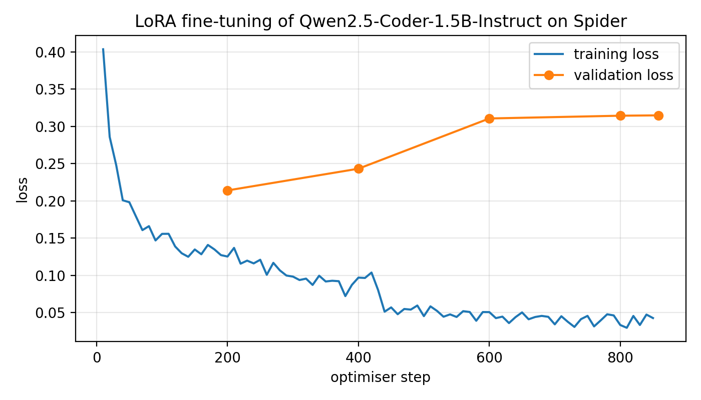

## 5.3 Method: LoRA fine-tuning (E4)

**Goal.** E1 shows what the base model can do from the prompt alone. E4 measures what training on Spider adds,
with nothing else changed: the model is evaluated zero-shot, with the same prompt and the same decoding as E1.

**Training data.** We build training examples from Spider's `train_spider` and `train_others` files (8,659 questions
in total). Each example is a (prompt, SQL) pair. The prompt is produced by exactly the same function as the E1 prompt
(`zero_shot_messages`, version `zeroshot-v1`): a system instruction, the schema as `CREATE TABLE` statements with
three sample rows per table, the question, and the `-- SQL:` prefix, wrapped in the model's chat template. Using the same
prompt in training and evaluation means that any change in accuracy comes from fine-tuning and not from a different
prompt format.

**Validation split.** We hold out 15 databases for validation (717 questions) and train on the other 131
(7,942 questions). The split is by *database*, not by question, so that validation measures performance on unseen
schemas, as the real task does. Spider's dev set is not used for model selection and stays reserved for the final
evaluation.

**Length filter.** The prompt with schema and sample rows can be long. Examples longer than 1,536 tokens are
**dropped, not truncated**, because truncating from the end would remove the SQL answer. This leaves 6,855
training and 568 validation examples (1,087 and 149 dropped, 13.7% and 20.8%). The model therefore sees fewer
examples with very large schemas. **[TODO: mention as a limitation in the Conclusion.]**

**Loss on the answer only.** The prompt tokens are masked out of the loss (label −100), so the model is trained to
produce the SQL and not to copy the prompt. An end-of-sequence token is appended to the SQL so that the model
learns when to stop.

**Model and QLoRA configuration.**

| Setting | Value |
|---|---|
| Base model | Qwen2.5-Coder-1.5B-Instruct |
| Quantisation | 4-bit NF4, double quantisation, fp16 compute |
| LoRA rank *r* / alpha / dropout | 16 / 32 / 0.05 |
| LoRA target modules | q, k, v, o, gate, up, down projections (all attention and MLP layers) |
| Trainable parameters | 18,464,768 of 1,562,179,072 (1.18%) |
| Epochs | 2 (858 optimiser steps) |
| Batch size | 2 per step × 8 gradient accumulation = 16 |
| Learning rate | 2e-4, cosine schedule, 25 warm-up steps |
| Optimiser | paged AdamW (8-bit) |
| Precision / memory | fp16, gradient checkpointing |
| Max sequence length | 1,536 tokens |
| Seed | 42 |
| Hardware | one NVIDIA Tesla T4 (16 GB), Google Colab |

We use the 1.5B model, not the 7B model, because on a free T4 the 1.5B model takes about 17 s per step
(about 4 hours for the full run) and the 7B model would be roughly 4–5 times slower. This is also the same model
as in E1–E3, so all experiments are comparable.

**Checkpointing.** Free Colab sessions can disconnect and delete local files. Checkpoints were therefore written
every 200 steps (every 10 steps in the short test) to Google Drive, and training could be continued with `--resume`.
The session disconnected once during the real run, after step 626. We resumed from the step-600 checkpoint, so
about 26 steps were repeated and nothing else was lost.

**Training cost and curve.** The run took about 4.3 hours of GPU time on one T4: about 2.9 hours to reach step 600
and 1.44 hours (`train_hours` = 1.437 in `config.json`) for the remaining 258 steps after the resume. Training loss fell from 0.40 (step 10) to about 0.04 (end), with a sharp drop at the start of epoch 2 (step
about 430), when the model sees the same examples again. Validation loss, measured on 15 unseen databases, was lowest at
the first check and then rose: 0.214 (step 200), 0.243 (400), 0.311 (600), 0.314 (800), 0.315 (858; Figure X, `figures/e4_loss_curve.png`).
This is overfitting to the training databases. Loss is not accuracy: the final adapter still improved execution accuracy
on the unseen dev databases (E4 vs E1, Section 7). All E4 results use the **final checkpoint (step 858), not the checkpoint with the lowest
validation loss (step 200)**: we did not select a checkpoint by validation loss, and only the last two checkpoints were kept.
Stopping after about 200–400 steps might have given an equal or better adapter at a fraction of the 4.3 GPU-hours.
We did not test this. All numbers come from a single training run with one seed (42), so we cannot give a confidence interval.

*Figure X. Training loss (blue) and validation loss (orange, 15 unseen databases) for the LoRA fine-tuning of
Qwen2.5-Coder-1.5B-Instruct on Spider. Validation loss is lowest at step 200 and then rises, while training loss keeps falling.*

**Evaluation.** The saved adapter (about 74 MB) is loaded on top of the base model and evaluated on the same
balanced 200-question dev subset as E1, with the same prompt, greedy decoding and 256 new tokens. The results,
compared with E1, are given below in the E4 results section. E5 adds the
self-correction loop of Part 3 on top of this adapter.

---

## 7.x Results: E4 (fine-tuned, zero-shot)

E4 uses the same prompt (`zeroshot-v1`), the same balanced 200-question dev subset, and the same greedy decoding and
scorer as E1. Only the LoRA adapter is added. (The base model was loaded in fp16 and the adapter merged, as in E1.)

| Run | Easy | Medium | Hard | Extra hard | Overall | Exec errors |
|---|---:|---:|---:|---:|---:|---:|
| E1 zero-shot (base) | 88.0 | 64.0 | 50.0 | 40.0 | 60.5 | 18.5% |
| **E4 fine-tuned** | 96.0 | 82.0 | 54.0 | 44.0 | **69.0** | 12.0% |
| Change | +8.0 | +18.0 | +4.0 | +4.0 | **+8.5** | −6.5 pts |

Fine-tuning improved every difficulty level and cut the execution-error rate from 18.5% to 12.0%. The gain is largest on
medium queries (+18 points, 9 more of 50 correct). On hard and extra-hard queries it is only +4 points, and 18% and 24% of
those predictions still fail to execute. Each level has only 50 questions, so one question is 2 points within a level and the differences on hard
and extra hard (2 questions each) are within noise; we ran one seed. The balanced subset is small, so **the full-dev result below
is the stronger evidence**.

**Full dev set (1,034 questions).** To check that the subset result is not luck, we also ran E4 on all dev questions:

| Full dev | Easy | Medium | Hard | Extra hard | Overall | Exec errors |
|---|---:|---:|---:|---:|---:|---:|
| E1 zero-shot (base) | 82.7 | 65.5 | 51.1 | 45.2 | 63.9 | 17.7% |
| **E4 fine-tuned** | 88.7 | 74.0 | 57.5 | 48.2 | **70.6** | 11.1% |
| Change | +6.0 | +8.5 | +6.4 | +3.0 | **+6.7** | −6.6 pts |

The improvement holds on every level (+6.7 points overall) and is consistent with the subset (+8.5), but it is smaller on medium
queries (+8.5 here against +18 on the 50-question subset), so part of the subset's medium gain was sampling noise.
Extra-hard queries gain the least (+3.0), and 22.3% of their predictions still fail to execute.

**Error analysis (25 incorrect E4 predictions, balanced subset, stratified by difficulty; same categories as E1).**

| Category | Easy | Medium | Hard | Extra | Total |
|---|---:|---:|---:|---:|---:|
| Schema linking | 0 | 2 | 4 | 4 | 10 (40%) |
| JOIN | 0 | 3 | 1 | 1 | 5 (20%) |
| Condition values | 0 | 2 | 0 | 0 | 2 (8%) |
| SELECT / ORDER BY / DISTINCT | 1 | 1 | 0 | 0 | 2 (8%) |
| Nesting / set operations | 0 | 0 | 2 | 0 | 2 (8%) |
| GROUP BY / aggregation | 0 | 0 | 1 | 1 | 2 (8%) |
| Questionable gold | 1 | 0 | 0 | 1 | 2 (8%) |

Schema linking remains the main failure (40%, down from 48% for E1, but both are samples of 25). The model still invents
or misplaces column names, for example `T1.pet_type` when the column is `PetType`, `Weight` taken from `car_names` instead of
`cars_data`, or `winner_name` taken from `players` instead of `matches`. In the E1 sample, 5 of the 6 easy errors
were schema-linking errors; E4 gets only 2 of 50 easy questions wrong and neither is a schema-linking error, so the simple column
mistakes are largely gone, but the harder multi-table cases remain. All ten schema-linking errors fail with "no such column/table",
which gives explicit feedback, so execution-based self-correction (E5) could repair some of them. The five JOIN errors
run without error but return the wrong rows (a missing table, or joining on the wrong keys), as do nesting errors such as needing
`INTERSECT`, which execution feedback alone cannot detect. Two of the 25 are arguably not model errors (one question does not say what to sort by;
one sums an injuries column where the gold query counts rows). Full labels and notes:
`results/e4_finetuned_Qwen2.5-Coder-1.5B-Instruct_balanced/error_analysis.csv`.
